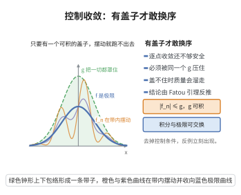

# 控制收敛定理

> **一句话大白话**：只要一串函数逐点收敛，并且它们都被一个"可积的大伞"罩着、不会发散，那么"积分"与"极限"就可以交换顺序。
>
> **小例子**：股价函数趋于极限，只要所有时刻都被一个可积上界罩住，那么期望的极限等于极限的期望。

## 一、定理介绍

> **前置依赖**：Lebesgue 积分与可测函数、逐点几乎处处收敛、可积控制函数、Fatou 引理、三角不等式

设 $\{f_n\}$ 可测且 $f_n\to f$ a.e.，存在可积 $g$ 使 $|f_n|\le g$ a.e.。则 $f$ 可积，且

$$
\lim_{n\to\infty}\int|f_n - f|\,d\mu = 0, \qquad \lim_{n\to\infty}\int f_n\,d\mu = \int f\,d\mu.
$$

## 几何直观

图意在说明：逐点收敛之外还需要一个可积的控制函数，才能保证积分收敛到极限的积分。

## 二、原理思路

由 $|f_n|\le g$ 与极限传递，$|f|\le g$ 故 $f$ 可积。构造非负函数 $h_n=2g-|f_n-f|\ge0$，其逐点收敛到 $2g$，对 $h_n$ 用 Fatou 引理，整理后得到 $\limsup\int|f_n-f|\le0$，结合非负性即得 $L^1$ 收敛。

## 三、定理的严格表述

若存在可积的 $g$ 使 $|f_n|\le g$ 且 $f_n\to f$ a.e.，则 $f\in L^1$ 且

$$
\lim_{n\to\infty}\int|f_n-f|\,d\mu = 0.
$$

## 四、证明过程

1. **可积性**：$f_n\to f$ a.e. 结合 $|f|\le g$ 得 $f\in L^1$。
2. **辅助函数**：$h_n=2g-|f_n-f|\ge0$，$h_n\to2g$ a.e.。
3. **Fatou**：$\int2g\le\liminf\int(2g-|f_n-f|)$。
4. **整理**：移项得 $\limsup\int|f_n-f|\le0$，故 $\int|f_n-f|\to0$。
5. **结论**：$|\int f_n-\int f|\le\int|f_n-f|\to0$。

## 五、应用与意义

控制收敛定理解释了积分的连续性与交换律：在可积控制下，极限、积分、期望可自由交换，是分析中"在积分号下取极限/求导/级数求和"的最常用依据。它推广了单调收敛定理，是概率论中交换期望与极限、鞅收敛、遍历定理与统计大样本理论的核心工具。

## 课堂问答

**老师**：有了可积的控制函数，为什么积分就能与极限交换？

**学生**：先给结论——若 $f_n\to f$ a.e. 且存在可积 $g$ 使 $|f_n|\le g$ a.e.，则 $f$ 可积且 $\int|f_n-f|\,d\mu\to0$，从而 $\int f_n\,d\mu\to\int f\,d\mu$。

**老师（追问）**：证明的技术要点在哪？

**学生**：构造非负函数 $h_n=2g-|f_n-f|\ge0$，它逐点收敛到 $2g$；对 $h_n$ 用 Fatou 引理得 $\int2g\le\liminf\int(2g-|f_n-f|)$，移项得 $\limsup\int|f_n-f|\le0$，结合非负性即 $L^1$ 收敛，最后 $|\int f_n-\int f|\le\int|f_n-f|\to0$。

**老师（拓展）**：为什么"可积控制"必不可少？

**学生**：可积的控制函数是保证概率质量不"逃逸到无穷"的唯一条件。否则 $f_n=\mathbf 1_{[n,n+1]}$ 逐点趋于 $0$，但每个积分都是 $1$。它是"积分号下取极限、求导、级数求和"最常用的依据，也是概率论中交换期望与极限的核心。
