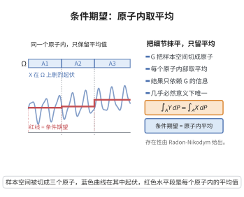

# 条件期望的存在唯一性

> **一句话大白话**：当你只掌握了一部分信息时，随机变量的条件期望就是"在这部分信息下最合理的最佳猜测"——它是唯一的，且在所有可测函数中误差最优。
>
> **小例子**：只知道某天是晴天时，对降雨量的最佳估计就是"在晴天信息下的平均数"，即条件期望。

## 一、定理介绍

> **前置依赖**：概率空间与子 σ-代数、Lebesgue 积分、绝对连续测度、Radon-Nikodym 定理、正负分解

设 $(\Omega,\mathcal{F},\mathbb{P})$ 为概率空间，$X$ 可积，$\mathcal{G}\subset\mathcal{F}$ 为子 σ-代数。则存在唯一的（a.s. 意义下）$\mathcal{G}$-可测 $Y$ 满足对任意 $A\in\mathcal{G}$：

$$
\int_A Y\,d\mathbb{P} = \int_A X\,d\mathbb{P},
$$

该 $Y$ 称为条件期望 $\mathbb{E}[X\mid\mathcal{G}]$。

## 几何直观

图意在说明：条件期望把每个原子内的起伏抹平，只留下与子 σ 代数相容的平均水平。

## 二、原理思路

用 Radon-Nikodym 定理构造。对 $X\ge0$，定义 $\mathcal{G}$ 上的测度 $\nu(A)=\int_A X d\mathbb{P}$，它显然关于 $\mathbb{P}|_\mathcal{G}$ 绝对连续，故存在 $\mathcal{G}$-可测密度 $Y$ 正是所要的条件期望；一般可积 $X$ 用正负分解 $X=X^+-X^-$ 组合，最后用积分一致得零推出唯一性。

## 三、定理的严格表述

设 $X\in L^1(\Omega,\mathcal{F},\mathbb{P})$，$\mathcal{G}\subset\mathcal{F}$。存在 a.s. 唯一的 $\mathcal{G}$-可测随机变量 $Y=\mathbb{E}[X\mid\mathcal{G}]$，使

$$
\int_A Y\,d\mathbb{P}=\int_A X\,d\mathbb{P}\qquad\forall A\in\mathcal{G}.
$$

## 四、证明过程

1. **非负情形**：$\nu(A)=\int_A X\,d\mathbb{P}$（$A\in\mathcal{G}$）为有限测度且 $\nu\ll\mathbb{P}|_\mathcal{G}$。
2. **RN 定理**：存在 $\mathcal{G}$-可测 $Y\ge0$ 使 $\nu(A)=\int_A Y\,d\mathbb{P}$，恰为条件期望。
3. **一般函数**：$X=X^+-X^-$ 分别构造 $Y_1,Y_2$，令 $Y=Y_1-Y_2$。
4. **唯一性**：$\int_A(Y_1-Y_2)d\mathbb{P}=0$ 对 $\mathcal{G}$ 中 $A$ 成立，取 $A=\{Y_1-Y_2>0\}$ 得概率为零。

## 五、应用与意义

条件期望是最优预测、鞅理论、马尔可夫性质与随机控制的核心概念。其存在唯一性为概率论中"给定信息的最优估计"奠定了严格基础，并引申出全期望公式、条件方差、鞅收敛等一整套工具，广泛应用于滤波、统计、金融定价与机器学习中的条件模型。

## 课堂问答

**老师**：条件期望凭什么既存在又唯一？

**学生**：先给结论——对可积 $X$ 与子 $\sigma$-代数 $\mathcal G\subset\mathcal F$，存在 a.s. 唯一的 $\mathcal G$-可测 $Y$ 使 $\int_AY\,d\mathbb{P}=\int_AX\,d\mathbb{P}$（$\forall A\in\mathcal G$），这个 $Y$ 就是 $\mathbb{E}[X\mid\mathcal G]$。

**老师（追问）**：存在性是怎么得到的？

**学生**：对 $X\ge0$ 在 $\mathcal G$ 上定义测度 $\nu(A)=\int_AX\,d\mathbb{P}$，显然 $\nu\ll\mathbb{P}|_{\mathcal G}$，Radon-Nikodym 定理给出密度 $Y=\frac{d\nu}{d\mathbb{P}|_{\mathcal G}}$，恰为条件期望；一般可积 $X$ 用正负分解 $X=X^+-X^-$ 组合。唯一性取 $A=\{Y_1-Y_2>0\}$ 得概率为零。

**老师（拓展）**：它在概率论中是什么地位？

**学生**：它是最优预测与鞅论的基石——$\mathcal G$-可测的 $Y$ 正是 $X$ 在 $L^2$ 意义下的正交投影（条件方差最小）。它导出全期望公式、条件方差与鞅收敛，并广泛用于滤波、统计估计与金融定价。常见误区是把它当成普通的数值平均。

## 相关条目

- [条件期望的存在唯一性（第24级-概率论基础）](../第24级-概率论基础/条件期望的存在唯一性.md)：与本条目为同一定理，另收录于第24级-概率论基础，可交叉参考。
