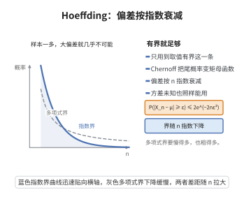

# Hoeffding不等式

> **一句话大白话**：一组相互独立且有界的随机变量，它们的和偏离期望的概率随偏离量增大而指数式变小，衰减快慢完全由每个变量取值范围的长度决定。

> **小例子**：抛 $n$ 次公平硬币，用 $\bar X$ 表示正面出现的比例。则 $\mathbb{P}(|\bar X-\frac12|\ge\varepsilon)\le 2e^{-2n\varepsilon^{2}}$。取 $n=100$、$\varepsilon=0.1$，上界约为 $2e^{-2}\approx 0.27$。

## 一、定理介绍

> **前置依赖**：马尔可夫不等式、Jensen不等式、矩母函数、独立随机变量、Chernoff方法。

Hoeffding 不等式由丹麦裔美国统计学家 Wassily Hoeffding（1914–1991）在 1963 年发表于《Journal of the American Statistical Association》的论文《Probability Inequalities for Sums of Bounded Random Variables》中提出，是集中不等式（concentration inequality）理论中最基础也最著名的结果之一。在它之前，处理随机变量之和尾概率的主要工具有两类：一是马尔可夫、切比雪夫型不等式，它们只使用一阶、二阶矩，给出的界是多项式衰减，在需要高置信度时过于粗糙；二是 Bernstein 不等式与 Cramér 的指数型结果，它们能给出指数衰减，但依赖方差或矩母函数在原点邻域内的存在性，而这些量在统计问题中往往未知或难以估计。

Hoeffding 的核心动机是：在许多统计与学习问题中（如抽样调查、经验风险估计、U 统计量、随机算法的性能分析），单个变量是天然有界的，例如取值落在 $[0,1]$ 或 $[-1,1]$ 内，而"有界"这一信息最稳健、最容易验证。他证明了只要利用取值范围的长度，就能得到指数型尾界，且无需任何方差信息。他还给出了著名的 Hoeffding 引理，把有界零均值随机变量的矩母函数由 $\exp(t^{2}(b-a)^{2}/8)$ 控制，这一引理成为后来 Azuma 不等式、McDiarmid 不等式、各类集中不等式等一系列结果的起点，也是统计学习理论中泛化界推导的标准工具。

## 几何直观

图意在说明：只要随机变量有界，样本均值的偏差概率就按指数速度衰减，无需方差信息。

## 二、原理思路

1. 先用 Chernoff 方法把尾概率转化为矩母函数：对任意 $t>0$，由马尔可夫不等式得 $\mathbb{P}(S_n-\mathbb{E}S_n\ge n\varepsilon)\le e^{-tn\varepsilon}\,\mathbb{E}[e^{t(S_n-\mathbb{E}S_n)}]$，另一侧用 $-t$，把问题化归为控制矩母函数。

2. 用独立性把和的矩母函数分解为各变量矩母函数之积，于是只需控制单个有界零均值变量的矩母函数，这正是 Hoeffding 引理的内容：若 $a\le X\le b$ 且 $\mathbb{E}X=0$，则 $\mathbb{E}[e^{tX}]\le e^{t^{2}(b-a)^{2}/8}$。

3. 把引理代回，得到每个变量贡献因子 $e^{t^{2}(b_i-a_i)^{2}/8}$，合并后对变元 $t$ 求最小值（取 $t=4n\varepsilon/\sum_i(b_i-a_i)^{2}$）即得指数型界，再利用对称性把单侧界合成为双侧界。

## 三、定理的严格表述

### Hoeffding 引理

设 $X$ 为随机变量，$\mathbb{E}X=0$ 且 $a\le X\le b$（$a<b$）。则对任意 $t\in\mathbb{R}$ 有

$$
\mathbb{E}\left[e^{tX}\right]\le \exp\left(\frac{t^{2}(b-a)^{2}}{8}\right).
$$

### Hoeffding 不等式

设 $X_1,\dots,X_n$ 相互独立，且 $X_i\in[a_i,b_i]$，记 $S_n=\sum_{i=1}^{n}X_i$。则对任意 $\varepsilon>0$，

$$
\mathbb{P}\left(S_n-\mathbb{E}S_n\ge n\varepsilon\right)\le \exp\left(-\frac{2n^{2}\varepsilon^{2}}{\sum_{i=1}^{n}(b_i-a_i)^{2}}\right).
$$

$$
\mathbb{P}\left(\left|S_n-\mathbb{E}S_n\right|\ge n\varepsilon\right)\le 2\exp\left(-\frac{2n^{2}\varepsilon^{2}}{\sum_{i=1}^{n}(b_i-a_i)^{2}}\right).
$$

特别地，当所有 $X_i\in[0,1]$ 时，对样本均值 $\bar X=S_n/n$ 有

$$
\mathbb{P}\left(\left|\bar X-\mathbb{E}\bar X\right|\ge\varepsilon\right)\le 2e^{-2n\varepsilon^{2}}.
$$

## 四、证明过程

**步骤 1（Chernoff 方法）。** 设 $Y_i=X_i-\mathbb{E}X_i$，则 $\mathbb{E}Y_i=0$，且 $Y_i$ 仍落在长度 $b_i-a_i$ 的区间内。对任意 $t>0$，由马尔可夫不等式

$$
\mathbb{P}\left(\sum_{i=1}^{n}Y_i\ge n\varepsilon\right)=\mathbb{P}\left(e^{t\sum_i Y_i}\ge e^{tn\varepsilon}\right)\le e^{-tn\varepsilon}\,\mathbb{E}\left[e^{t\sum_{i=1}^{n}Y_i}\right].
$$

**步骤 2（独立性分解）。** 由 $Y_1,\dots,Y_n$ 相互独立，矩母函数可分解为

$$
\mathbb{E}\left[e^{t\sum_{i=1}^{n}Y_i}\right]=\prod_{i=1}^{n}\mathbb{E}\left[e^{tY_i}\right].
$$

**步骤 3（Hoeffding 引理）。** 设 $\mathbb{E}Y=0$、$a\le Y\le b$。由 $y\mapsto e^{ty}$ 在 $[a,b]$ 上的凸性，对任意 $y\in[a,b]$ 有

$$
e^{ty}\le \frac{b-y}{b-a}e^{ta}+\frac{y-a}{b-a}e^{tb}.
$$

两端取期望并用 $\mathbb{E}Y=0$，得

$$
\mathbb{E}\left[e^{tY}\right]\le \frac{b\,e^{ta}-a\,e^{tb}}{b-a}.
$$

令 $p=\frac{-a}{b-a}\in[0,1]$，则系数满足 $\frac{b}{b-a}=1-p$、$\frac{-a}{b-a}=p$，于是

$$
\mathbb{E}\left[e^{tY}\right]\le e^{ta}\left[(1-p)+p\,e^{t(b-a)}\right].
$$

记 $u=t(b-a)$、$L(u)=\log\left(1-p+p e^{u}\right)$。直接计算得 $L(0)=0$、$L'(0)=p$、$L''(u)=\frac{p(1-p)e^{u}}{(1-p+pe^{u})^{2}}\le\frac14$，故由带余项的泰勒展开

$$
L(u)\le L(0)+L'(0)u+\frac{u^{2}}{8}=pu+\frac{u^{2}}{8}.
$$

代回并注意 $a(1-p)+pb=\frac{ab}{b-a}-\frac{ab}{b-a}=0$，得到 $ta+pu=t\left[a(1-p)+pb\right]=0$，因此

$$
\mathbb{E}\left[e^{tY}\right]\le \exp\left(ta+pu+\frac{u^{2}}{8}\right)=\exp\left(\frac{t^{2}(b-a)^{2}}{8}\right).
$$

**步骤 4（合并单侧界）。** 记 $c_i=b_i-a_i$，把步骤 3 用于每个 $Y_i$ 并利用步骤 2：

$$
\mathbb{P}\left(\sum_{i=1}^{n}Y_i\ge n\varepsilon\right)\le \exp\left(-tn\varepsilon+\frac{t^{2}}{8}\sum_{i=1}^{n}c_i^{2}\right).
$$

**步骤 5（对 $t$ 求最小）。** 右端指数是 $t$ 的二次函数，在 $t=\dfrac{4n\varepsilon}{\sum_i c_i^{2}}>0$ 处取最小，代回得

$$
\mathbb{P}\left(S_n-\mathbb{E}S_n\ge n\varepsilon\right)\le \exp\left(-\frac{2n^{2}\varepsilon^{2}}{\sum_{i=1}^{n}c_i^{2}}\right).
$$

**步骤 6（双侧界与 $[0,1]$ 情形）。** 对 $-Y_i$ 重复步骤 1 至 5，区间长度不变，故反向偏差服从同一界；由联合界把两侧相加即得双侧不等式。当 $X_i\in[0,1]$ 时 $c_i=1$，右端化为 $2e^{-2n\varepsilon^{2}}$。$\square$

## 五、应用与意义

- 统计学习理论：它是推导 PAC 学习基本定理、VC 维泛化界、Rademacher 复杂度界时最常用的集中工具，用于控制经验风险与期望风险之差。
- 抽样与估计：样本均值的置信区间、A/B 测试与蒙特卡洛估计的误差保证，可直接由 $2e^{-2n\varepsilon^{2}}$ 反解所需样本量 $n$。
- 随机算法分析：随机化算法的成功概率、负载均衡中最大负载的界等都依赖它。
- 方法论意义：它把"独立 + 有界"这一最弱假设转化为指数型尾界，启发了 Azuma 不等式、McDiarmid 有界差分不等式等去独立化、去同分布的推广。

## 课堂问答

**老师**：Hoeffding 给出的衰减率由什么决定？

**学生**：结论：设 $X_i\in[a_i,b_i]$ 相互独立，则

$$
\mathbb{P}\big(|S_n-\mathbb{E}S_n|\ge n\varepsilon\big)\le2\exp\!\left(-\frac{2n^2\varepsilon^2}{\sum_{i=1}^n(b_i-a_i)^2}\right),
$$

衰减快慢完全由各区间的长度 $b_i-a_i$ 决定；当所有 $X_i\in[0,1]$ 时化为 $\mathbb{P}(|\bar X-\mathbb{E}\bar X|\ge\varepsilon)\le2e^{-2n\varepsilon^2}$，指数里的 $n$ 说明样本越多集中越强。

**老师（追问）**：Chernoff 方法加上 Hoeffding 引理，具体怎么拼起来？

**学生**：先对 $t>0$ 用马尔可夫不等式把尾概率换成矩母函数，

$$
\mathbb{P}\Big(\sum_iY_i\ge n\varepsilon\Big)\le e^{-tn\varepsilon}\,\mathbb{E}\Big[e^{t\sum_iY_i}\Big],
$$

其中 $Y_i=X_i-\mathbb{E}X_i$；独立性把矩母函数拆成乘积 $\prod_i\mathbb{E}[e^{tY_i}]$，再用 Hoeffding 引理 $\mathbb{E}[e^{tY}]\le e^{t^2(b-a)^2/8}$ 逐项控制，合并得 $\exp(-tn\varepsilon+\frac{t^2}{8}\sum_i c_i^2)$，对 $t$ 取最小 $t=\frac{4n\varepsilon}{\sum_i c_i^2}$ 即得单侧界，双侧再乘系数 $2$。

**老师（拓展）**：引理本身是怎么凑出 $e^{t^2(b-a)^2/8}$ 的？

**学生**：用 $e^{ty}$ 在 $[a,b]$ 上的凸性把它压到连接两端的直线上，即 $e^{ty}\le\frac{b-y}{b-a}e^{ta}+\frac{y-a}{b-a}e^{tb}$，取期望并用 $\mathbb{E}Y=0$ 化为 $e^{ta}[(1-p)+pe^{u}]$（记 $u=t(b-a)$、$p=\frac{-a}{b-a}$）；对 $\log$ 那部分做泰勒展开，其二阶导不超过 $\frac14$，得 $\le e^{t^2(b-a)^2/8}$。误区是以为要事先知道方差——恰恰相反，Hoeffding 只需"有界"这一最易验证的信息。

## 相关条目

- [McDiarmid不等式](./McDiarmid不等式.md)：把 Hoeffding 不等式推广到不独立、依赖有界差分的函数情形。
- [VC维的泛化界](./VC维的泛化界.md)：以 Hoeffding 不等式为基本工具推导一致泛化界。
- [Rademacher复杂度的泛化界](./Rademacher复杂度的泛化界.md)：用 Hoeffding 型引理控制 Rademacher 复杂度。
- [PAC学习的基本定理](./PAC学习的基本定理.md)：用 Hoeffding 不等式把经验误差与真实误差联系起来。
- [切比雪夫型指数不等式](../第102级-大偏差理论/切比雪夫型指数不等式.md)：同属指数型尾界的构造，以矩母函数界的形式给出。
- [马尔可夫不等式](../第24级-概率论基础/马尔可夫不等式.md)：Chernoff 方法的第一步。
- [Jensen不等式](../第24级-概率论基础/Jensen不等式.md)：用于处理凸函数与条件期望。
