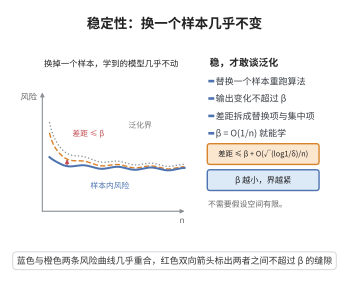

# 稳定性与泛化

> **一句话大白话**：学习算法对"换一个样本"越不敏感（稳定性系数 $\beta$ 越小），它的泛化误差就越被限制在经验误差附近，从而越不容易过拟合。
>
> **小例子**：L2 正则化的岭回归满足 $\beta=O(1/n)$，此时界式右端为 $O(1/\sqrt{n})$，说明正则化网络的泛化误差以平方根速率收敛。

## 一、定理介绍

> **前置依赖**：均匀稳定性定义、期望泛化差距分解、McDiarmid 不等式、损失函数有界性、样本替换技巧

设学习算法 $\mathcal{A}$ 具有 $\beta$-均匀稳定性，损失取值于 $[0,1]$。则对任意 $\delta>0$，以至少 $1-\delta$ 的概率
$$
R(\mathcal{A}_S)\le \hat R_n(\mathcal{A}_S)+\beta+(2n\beta+1)\sqrt{\frac{\log\frac1\delta}{2n}}.
$$
特别地，当 $\beta=O(1/n)$ 时泛化误差以 $O(1/\sqrt{n})$ 收敛。

## 几何直观

图意在说明：算法对单个样本不敏感时，经验风险与真实风险的差距可以由稳定性直接控制。

## 二、原理思路

先证明"期望泛化差距" $\mathbb{E}[R(\mathcal{A}_S)-\hat R_n(\mathcal{A}_S)]\le\beta$：引入把第 $i$ 个样本替换为独立同分布样本 $z_i'$ 的数据集 $S^{(i)}$，利用对称性把差距写成若干"仅差一个样本"的两个模型损失的差，再由 $\beta$-均匀稳定性逐项上界为 $\beta$。随后用 McDiarmid 不等式控制 $\Phi(S)=R(\mathcal{A}_S)-\hat R_n(\mathcal{A}_S)$ 围绕期望的集中性。

## 三、定理的严格表述

**$\beta$-均匀稳定性。** 对任意两个相差一个样本的训练集 $S,S'$，
$$
\sup_{x,y}|L(y,\mathcal{A}_S(x))-L(y,\mathcal{A}_{S'}(x))|\le\beta.
$$

**泛化界。** 若 $\mathcal{A}$ 为 $\beta$-均匀稳定且 $L\in[0,1]$，则对任意 $\delta>0$，以至少 $1-\delta$ 的概率
$$
R(\mathcal{A}_S)\le \hat R_n(\mathcal{A}_S)+\beta+(2n\beta+1)\sqrt{\frac{\log\frac1\delta}{2n}}.
$$

## 四、证明过程

**步骤1：期望界分解。** 令 $S=\{z_1,\dots,z_n\}$，$S^{(i)}$ 把 $z_i$ 换成 $z_i'$。由对称性 $\mathbb{E}[L(z_i,\mathcal{A}_S)]=\mathbb{E}[L(z_i',\mathcal{A}_{S^{(i)}})]$，故
$$
\mathbb{E}[R(\mathcal{A}_S)-\hat R_n(\mathcal{A}_S)]=\frac1n\sum_{i=1}^n\mathbb{E}\left[L(z_i',\mathcal{A}_S)-L(z_i',\mathcal{A}_{S^{(i)}})\right]\le\beta.
$$

**步骤2：McDiarmid 集中。** 对 $\Phi(S)=R(\mathcal{A}_S)-\hat R_n(\mathcal{A}_S)$，替换一个样本时其差分至多为 $1/n+2\beta$，由 McDiarmid 不等式，以至少 $1-\delta$ 的概率
$$
\Phi(S)\le\mathbb{E}[\Phi(S)]+\left(\frac1n+2\beta\right)\sqrt{\frac{n\log\frac1\delta}{2}}.
$$

**步骤3：综合。** 由步骤1，$\mathbb{E}[\Phi(S)]\le\beta$，代入整理得
$$
R(\mathcal{A}_S)\le \hat R_n(\mathcal{A}_S)+\beta+(1/n+2\beta)\sqrt{\frac{n\log\frac1\delta}{2}},
$$
等价于定理形式。当 $\beta=O(1/n)$ 时右端为 $O(1/\sqrt{n})$。$\square$

## 五、应用与意义

稳定性把"泛化能力"归结为算法对数据扰动的鲁棒性，是无需显式复杂度度量的泛化途径。正则化网络（岭回归、SVM）因强凸惩罚而具有 $O(1/n)$ 稳定性，从而获得 $O(1/\sqrt{n})$ 的泛化速率。它也是研究在线学习、对抗鲁棒性与过拟合机理的重要视角。

## 课堂问答

**老师**：不数复杂度、也不看 VC 维，稳定性凭什么能推出泛化？

**学生**：结论：若算法 $\mathcal{A}$ 满足 $\beta$-均匀稳定性、损失取值于 $[0,1]$，则以至少 $1-\delta$ 的概率

$$
R(\mathcal{A}_S)\le\hat{R}_n(\mathcal{A}_S)+\beta+(2n\beta+1)\sqrt{\frac{\log\frac1\delta}{2n}}.
$$

当 $\beta=O(1/n)$ 时右端为 $O(1/\sqrt n)$。理由是把泛化拆成"期望差距有界 + 该差距集中"：期望差距本身不超过 $\beta$，其波动由 McDiarmid 控制。

**老师（追问）**：期望差距 $\mathbb{E}[R(\mathcal{A}_S)-\hat{R}_n(\mathcal{A}_S)]\le\beta$ 那步的关键是什么？

**学生**：关键是把第 $i$ 个样本替换为同分布独立样本 $z_i'$ 得 $S^{(i)}$，由对称性 $\mathbb{E}[L(z_i,\mathcal{A}_S)]=\mathbb{E}[L(z_i',\mathcal{A}_{S^{(i)}})]$，于是

$$
\mathbb{E}[R(\mathcal{A}_S)-\hat{R}_n(\mathcal{A}_S)]=\frac1n\sum_{i=1}^n\mathbb{E}\big[L(z_i',\mathcal{A}_S)-L(z_i',\mathcal{A}_{S^{(i)}})\big]\le\beta,
$$

每项用稳定性上界。随后对 $\Phi(S)=R(\mathcal{A}_S)-\hat{R}_n(\mathcal{A}_S)$，替换一个样本的差分至多 $1/n+2\beta$，再由 McDiarmid 得集中性。

**老师（拓展）**：这个视角下，"正则化为什么有用"该怎么解释？

**学生**：因为它把算法变"稳"。岭回归、软间隔 SVM 的强凸惩罚使解对单个样本不敏感，从而 $\beta=O(1/n)$，直接换来 $O(1/\sqrt n)$ 的泛化速率。注意误区：稳定性说的是"换一个样本模型不敏感"，并不等于训练误差小；一个稳定但欠拟合的模型同样可能是稳定的。
